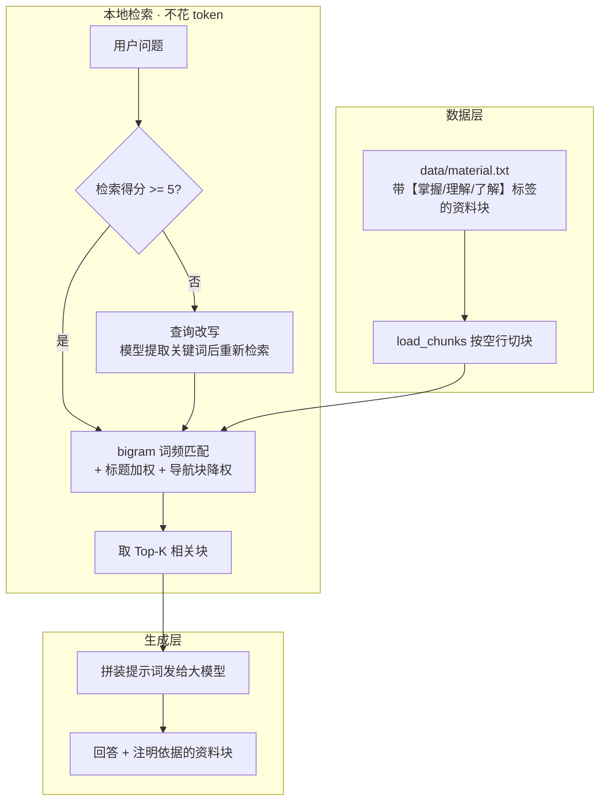

# ExamRAG — 有据可依的复习搭档

> **每个答案，都能翻回原文核对。**

[](https://github.com/hrh666/exam-rag/actions/workflows/tests.yml)


把课程资料切块存在本地，先检索、再交给大模型作答——**只依据你给的资料，不编造**。
纯 Python 标准库实现，零第三方依赖；回答会注明依据的资料块，答案对不对，翻一眼原文就能核对。

> CI 徽章在首次推送并触发 GitHub Actions 后开始显示状态。

---

## 为什么做这个

直接问大模型课程知识，它会一本正经地编造（幻觉）；自己翻教材，效率低、抓不住重点。
ExamRAG 把「找资料」这一步放在本地完成：不花 token、速度快、结果可见；只把最相关的几块资料发给模型生成答案，
并强制它在回答末尾注明依据。**可溯源，是这个工具最核心的设计目标。**

**适用人群**：备考某门课程的学生、整理笔记后想用自然语言检索的人、想基于讲义自动出题的讲师。
不限于教育领域——只要资料能按格式整理进 `data/material.txt`，工具就能直接用。

## 特性

- **零依赖**：只用 Python 标准库，clone 下来就能跑，不用配虚拟环境、不用 `pip install`。
- **可溯源**：回答必须注明依据的资料块；资料里没有的，明确回答「资料中未提及」。
- **检索结果可见**：命令行会打印「检索到：掌握·难度的定义、…」，你知道模型看到了什么。
- **三级掌握度分层出题**：按【掌握】/【理解】/【了解】标签加权，复习重点跟着掌握程度走。
- **查询改写兜底**：大白话提问检索不到关键词时，自动提取专业词重试。
- **重难点汇总 / 并列概念拆分**：「XX 的重难点」按掌握级标签挑内容；「信度和难度」拆成两段分别检索再合并。
- **`--dry-run` 离线演示**：不填 API Key 也能看到完整检索过程和提示词，适合演示与调试。
- **有测试、有 CI**：30 个离线单元测试，GitHub Actions 在 3.8 / 3.11 / 3.13 上自动跑。

## 架构



### 检索计分规则

1. 问题预处理：去掉客套词（「是什么」「哪些」等），切成两字词（bigram）。
2. 相关性 = 问题与资料块共同两字词的出现次数之和（计数而非集合，词频越高证据越强）。
3. 命中资料块标题标签额外 **×2**（标题是内容的浓缩摘要）。
4. 导航块（学习目标 / 导图 / 小结 / 练习）× **0.5**，给正文让位。
5. **仅在出题模式**按掌握等级加权：【掌握】×3、【理解】×2、【了解】×1（普通问答按纯词面相关度排序）。
6. 最高分 < 5 时触发**查询改写**：让模型提取关键词，再检索一次；分数变高才采用。

## 快速开始

需要 Python 3.8+。**不需要安装任何第三方包。**

```bash
git clone https://github.com/hrh666/exam-rag.git
cd exam-rag

# 复制配置模板并填入硅基流动 API Key（免费注册可得）
cp .env.example .env          # Windows PowerShell: Copy-Item .env.example .env
# 编辑 .env，把 SILICONFLOW_API_KEY 改成你的真实密钥

python -m examrag             # 启动交互模式
# 也可以：python tool.py      # 兼容原版入口
```

**没有 API Key 也能先看效果**（完全离线，只展示检索到的资料和提示词）：

```bash
python -m examrag -q "难度的定义" --dry-run
```

可选：安装为命令行工具后可在任意目录使用 `examrag` 命令。

```bash
pip install -e .
examrag --version
```

> ⚠️ 不要把真实 API Key 写进源码或提交到仓库。`.env` 已在 `.gitignore` 中；密钥请只放在 `.env` 或环境变量里。

## 命令行用法

| 参数 | 说明 | 示例 |
|------|------|------|
| 无参数 | 进入交互模式（原版体验） | `python -m examrag` |
| `-q`, `--question` | 单次提问，回答后退出 | `-q "难度的定义"` |
| `--exam [主题]` | 出题模式，直接跟主题 | `--exam 信度` |
| `--topic` | 查询某主题的知识点 / 重难点 | `--topic "信度的重难点"` |
| `--top-k N` | 检索资料块数量（默认 3） | `-q "效度" --top-k 5` |
| `--material PATH` | 指定自定义资料文件 | `--material my_notes.txt` |
| `--dry-run` | 只显示检索结果与提示词，不联网、不需密钥 | `-q "难度" --dry-run` |
| `--version` | 查看版本 | `--version` |

**退出码**（便于脚本调用）：`0` = 成功，`1` = 配置 / 网络 / 资料错误，`130` = 用户中断（Ctrl+C）。

交互模式里的写法：`直接提问`、`出题 信度`、`XX的重难点`、`退出`。

## 使用示例

```text
你：难度的定义是什么
（检索到：掌握·难度的定义、理解·信度的定义、理解·效度的定义）

AI：一句话结论：难度是衡量测验试题难易程度的指标，通常用通过率 P 表示……
展开：P=x̄/w 越大越简单；q=1−P 越大越难，报告时应注明用的是哪种。
依据：【掌握·难度的定义】

你：出题 信度
（检索到：掌握·重测信度、掌握·复本信度、掌握·重测信度的局限与适用｜等级：掌握、掌握、掌握）
AI：1.（简答）重测信度的误差变异来源是什么？……
```

更多完整示例见 [`examples/demo_question.txt`](examples/demo_question.txt) 与
[`examples/demo_exam.txt`](examples/demo_exam.txt)。

> **提问技巧**：带上主题词（「信度」「极端分组法」）命中率更高；纯大白话会自动触发关键词改写。
> 问「XX 的重难点」会按资料块的掌握级标签汇总考试重点。

## 配置说明

| 配置项 | 获取顺序（高 → 低） | 作用 |
|--------|-------------------|------|
| `SILICONFLOW_API_KEY` | 环境变量 → `.env` → 空 | 模型密钥；仅调用模型时需要 |
| `EXAMRAG_BASE_URL` | 环境变量 → `.env` → 默认硅基流动地址 | 任意 OpenAI 兼容接口 |
| `EXAMRAG_MODEL` | 环境变量 → `.env` → `Qwen/Qwen3-8B` | 模型名 |
| `EXAMRAG_MATERIAL` | 环境变量 → `.env` → `data/material.txt` | 自定义资料路径（相对路径以仓库根为基准） |
| `--material` | 命令行 | 最高优先级，覆盖以上所有配置 |

## 可替换的组件

| 组件 | 当前实现 | 可替换为 | 改动位置 |
|------|---------|---------|---------|
| 大模型 | 硅基流动 Qwen3-8B | 任意 OpenAI 兼容接口 | `config.py` 的 `get_base_url/get_model` 或环境变量 |
| 检索算法 | bigram 词频匹配 | 向量语义检索、BM25 | `examrag/retrieval.py` 的 `retrieve()` |
| 查询改写 | 低分时让模型提取关键词 | 删除或换成规则词典 | `examrag/smart.py` |
| 资料内容 | 《教育测量与评价》 | 任意领域结构化资料 | `data/material.txt` + `config.py` 的 `SYSTEM_PROMPT` |
| 分层权重 | 掌握 3 / 理解 2 / 了解 1 | 任意加权策略 | `config.py` 的 `LEVEL_WEIGHTS` |
| 交互界面 | 命令行 | Web 页面、机器人 | `examrag/cli.py` |

## 设计决策

- **纯标准库**：不装第三方包，规避环境配置与依赖冲突，任何人 clone 即可运行。
- **检索在本地**：不花 token、速度快，检索结果对用户可见，答案可溯源。
- **分层标签**：资料按教材学习目标标【掌握/理解/了解】三级，出题按此加权——这是本项目自己定的设计。
- **密钥惰性校验**：缺密钥时模块照常导入，检索与 `--dry-run` 仍可用；只有真正调用模型才报错，且给出中文提示。
- **依赖注入**：策略层通过 `ask_fn` 接收模型调用，测试与 dry-run 可用桩函数替换，完全离线。
- **查证式回答**：提示词强制「资料没有就回答未提及」，宁可不答也不编造。

## 项目结构

```text
exam-rag/
├── examrag/
│   ├── __init__.py       # 包标记与版本号
│   ├── __main__.py       # python -m examrag 入口
│   ├── config.py         # 环境变量 / .env / 路径 / 常量
│   ├── retrieval.py      # 纯本地检索（clean / bigrams / retrieve / ...）
│   ├── llm.py            # 网络层：ask() 与统一中文错误处理
│   ├── smart.py          # 查询改写 / 重难点 / 并列概念拆分
│   └── cli.py            # argparse、REPL、dry-run
├── data/material.txt     # 内置知识库（99 块，UTF-8）
├── tests/                # 30 个离线单元测试
├── examples/             # 示例输入输出
├── .github/workflows/    # CI：多版本 Python 跑测试
├── tool.py               # 兼容入口（python tool.py）
├── pyproject.toml        # 包声明与命令行入口
└── UPLOAD.md             # 从零上传 GitHub 的手把手指南
```

## 测试

```bash
python -m unittest discover -s tests -v
```

30 个测试全部离线运行，不需要 API Key，也不需要联网。GitHub Actions 会在每次 push / PR 时自动跑。

## 资料范围

内置《教育测量与评价》教材资料 **99 块**，覆盖第一、二、四、五、六章的内容块及章末小结、练习，
资料块带有【掌握 / 理解 / 了解】标签。当前资料中**第三章暂无正文块、第六章未设独立章节标题行**，
因此本项目不声称章节连续——这里只如实说明，不改动原始资料。

## 局限性

1. **检索基于词面匹配**，不理解语义；「哪个更重要」这类无主题词的问题命中率不如直接带关键词。
2. **资料需人工整理**：`material.txt` 要按格式手工准备，暂不支持直接导入 PDF / Word。
3. **单轮对话**：不支持追问上下文，每个问题独立检索。
4. **命令行界面**：面向能运行 Python 脚本的用户。
5. **依赖外部模型服务**：需要可访问的 OpenAI 兼容接口，回答质量受模型能力影响。
6. **重难点基于教材标签**：按资料块的【掌握】级标签挑选，未接入外部高频考点数据。
7. **提示词注入风险**：资料块来自用户或第三方文件，若内容不可信，可能影响模型行为；不要把密钥或不可信资料发给托管模型。
8. **测试边界**：调用链已用本地模拟 OpenAI 兼容接口做端到端测试（提问、出题、401、坏 JSON、结构异常），超时由单元测试覆盖；**未使用真实密钥调用商业模型服务**，实际回答质量取决于所配模型。

## Roadmap

- [x] 关键词检索 + 出题
- [x] 分层出题（按掌握等级加权）
- [x] 查询改写（大白话提问兜底）
- [x] 单元测试 + CI
- [x] 环境变量配置 + dry-run 离线演示
- [ ] 向量语义检索升级（解决词面匹配的局限）
- [ ] Web 界面
- [ ] 支持直接导入 PDF / Word 资料

## License

[MIT](LICENSE) © 2026 hrh666
