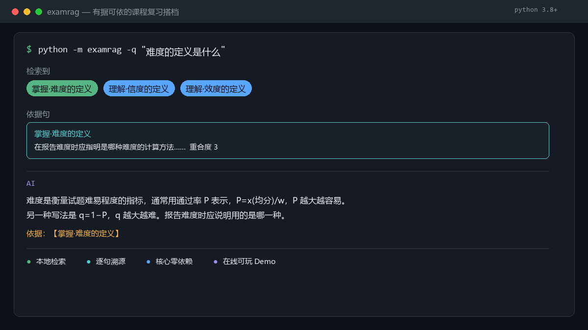

# ExamRAG

[](https://github.com/huiren789/exam-rag/actions/workflows/tests.yml)


[](https://examrag-demo.app.workbuddy.host/?sharecode=YTW7YFIS3R)

<div align="center">



**有据可依的课程复习搭档**

答案能翻回原文核对，检索只在本地跑，资料还能换成你自己的课。

[在线演示（免密钥）](https://examrag-demo.app.workbuddy.host/?sharecode=YTW7YFIS3R) ·
[解决什么问题](#解决什么问题) ·
[30 秒换成你的课程](#30-秒换成你的课程)

</div>

**语言**：**中文** · [English](README_en.md) · [日本語](README_ja.md) · [한국어](README_ko.md) · [Español](README_es.md)

> 内置《教育测量与评价》只是示例，**换成自己的 `data/material.txt` 就能用于任何课程**。核心检索只用 Python 标准库，不装第三方库也能跑。作者本人作为第一用户在真实复习场景中使用，并结合自建评测问题集完成 4 轮迭代。

## 解决什么问题

备考时直接问大模型，答案读着通顺，却可能没有出处；翻教材核对，又要从头找是哪一段。

ExamRAG 把找资料放在本地：检索离线跑，结果看得见，只把选中的几块交给模型。提示词限定模型只用这些资料、末尾写出依据，资料里没有的就回答「资料中未提及」。

## 30 秒换成你的课程

内置的《教育测量与评价》只是示例。要用在你自己的课程上，把复习资料按同样的格式整理成纯文本即可：

```text
【掌握·知识点名称】知识点正文，一段话说清一个概念。
【理解·另一个知识点】……
【了解·第三个知识点】……
```

三种标签（掌握 / 理解 / 了解）决定出题时的加权优先级，正文尽量一段一个概念。然后：

```bash
python -m examrag -q "你的问题" --material my.txt    # 换资料
```

也可以设 `EXAMRAG_MATERIAL=my.txt`，不必每次带参数。换资料后，检索、溯源、分层出题和 Web 界面照常用，不用改代码。资料格式细则见 [资料范围](#资料范围)。

## 主要功能

- 本地检索：按两字词出现次数匹配，标题命中加权，目录和小结类块降权。
- 语义检索：可选的 TF-IDF + 余弦相似度模式（`--semantic` / API 的 `semantic` 字段），同为纯标准库、离线可用，与词面检索互补。
- 向量检索：可选的 embedding 模式（`--vector` / API 的 `vector` 字段），首次需 `pip install -e ".[vector]"` 并下载模型；向量按原文哈希缓存，核心仍零依赖。
- 逐句依据：回答和检索结果都标出命中的原句与词面重合度，能从答案翻回具体一句资料。
- 检索评测：9 个人工标注问题，比较三种模式的 hit@1 / hit@3 / MRR。
- 分层出题：按【掌握】【理解】【了解】标签加权检索，优先从掌握级内容出题。
- 查询改写：检索分数偏低时，让模型提取关键词再检索一次。
- 重难点汇总：问「信度的重难点」这类问题时，让模型从标题清单里挑相关块。
- 并列概念拆分：问「信度和难度」时，拆成两段分别检索再合并结果。
- 离线演示：`--dry-run` 不调用模型，只打印检索结果和提示词，不需要密钥。
- Web 界面：一个单页演示界面，提问 / 出题 / 只看检索三个标签，展示带出处的回答；未配密钥时「只看检索」仍可用。
- 可选 HTTP API：FastAPI 提供 `/ask`、`/exam`、`/retrieve`、`/prompt`、`/health` 五个接口，带自动生成的 Swagger 文档。
- 零第三方依赖：核心与语义检索都用 Python 标准库；Web/API 与向量检索按需安装。89 个离线测试，CI 覆盖 Python 3.8 / 3.11 / 3.13，并含 ruff 静态检查。

## 安装方法

需要 Python 3.8 或更高版本。克隆之后可以直接运行，不需要安装依赖：

```bash
git clone https://github.com/huiren789/exam-rag.git
cd exam-rag
python -m examrag
```

旧入口 `python tool.py` 也能用。

如果要真正调用模型，需要准备一个 API Key。默认接的是硅基流动，也可以用其他 OpenAI 兼容接口：

```bash
cp .env.example .env        # Windows PowerShell: Copy-Item .env.example .env
```

编辑 `.env`，把 `SILICONFLOW_API_KEY` 改成自己的密钥。也可以不建文件，直接设环境变量 `SILICONFLOW_API_KEY`。`.env` 已在 `.gitignore` 里，不会被提交。

可选：装成本地命令 `examrag`。如果 pip 报 `Cannot import 'setuptools.build_meta'`，说明当前 Python 没装 setuptools，跳过这一步即可，不影响使用。

```bash
pip install -e .
examrag --version
```

向量检索（可选）：

```bash
pip install -e ".[vector]"
python -m examrag -q "难度的定义" --vector
```

首次运行会下载 `BAAI/bge-small-zh-v1.5`，向量缓存在 `.cache/`，不会提交到仓库。

## 使用方法

交互模式：

```bash
python -m examrag
```

进入后可以直接提问，也可以输入 `出题 信度`、`信度的重难点`，输入 `退出` 结束。

单次命令：

```bash
python -m examrag -q "难度的定义"              # 问一个问题
python -m examrag --exam 信度                  # 出题
python -m examrag --topic "信度的重难点"        # 汇总重难点
python -m examrag -q "难度的定义" --dry-run     # 离线看检索结果和提示词
python -m examrag -q "效度" --top-k 5          # 取 5 块资料
python -m examrag -q "信度" --material my.txt  # 换一份资料
python -m examrag -q "信度" --semantic          # 用 TF-IDF 语义检索挑块
python -m examrag -q "信度" --vector            # 用 embedding 向量检索挑块
python -m examrag.evaluate --mode lexical      # 跑检索评测
```

| 参数 | 说明 |
| --- | --- |
| `-q`, `--question` | 单次提问，回答后退出 |
| `--exam [主题]` | 出题模式，主题可直接跟在后面 |
| `--topic` | 查询某主题的知识点或重难点 |
| `--top-k N` | 检索几块资料，默认 3；重难点汇总会适当放宽 |
| `--material PATH` | 指定资料文件 |
| `--dry-run` | 只显示检索结果和提示词，不联网（含 `--vector` 组合，向量改用离线桩） |
| `--semantic` | 用 TF-IDF 语义检索挑块（默认词面匹配），离线零依赖 |
| `--vector` | 用 embedding 向量检索（需安装 `.[vector]` 并下载模型） |
| `--version` | 查看版本 |

退出码：`0` 成功，`1` 配置、网络或资料错误，`130` 用户按 Ctrl+C 中断。

## Web 界面与 HTTP API（可选）

核心工具不装任何第三方库也能用。想要网页界面或接口，再装这一组依赖：

```bash
pip install -e ".[api]"
python -m examrag.web        # Web 界面：http://127.0.0.1:8000
python -m examrag.api        # 只有接口：http://127.0.0.1:8000/docs
```

也可以直接 `uvicorn examrag.api:app --reload`（根路径同样带演示页）。Web 页的「向量检索」勾选框会在服务端未安装依赖时自动禁用。`/docs` 是 FastAPI 自动生成的交互文档，可直接在页面里填参数调试。

**在线演示**：https://examrag-demo.app.workbuddy.host/?sharecode=YTW7YFIS3R （线上未配置模型密钥，提问/出题由 WorkBuddy 云服务的免密钥模型通道驱动，检索与溯源仍由本地后端保证）。

五个接口：

| 方法 | 路径 | 作用 | 需要密钥 |
| --- | --- | --- | --- |
| GET | `/health` | 健康检查（版本、资料块数、密钥是否已配置，不回传密钥本身） | 否 |
| POST | `/retrieve` | 纯本地检索，返回命中的资料块、标签与掌握等级 | 否 |
| POST | `/prompt` | 返回组装好的提示词与检索结果（不调用模型），供前端直连云模型 | 否 |
| POST | `/ask` | 提问，检索后调用模型，回答注明依据 | 是 |
| POST | `/exam` | 出题，按掌握等级加权检索后让模型出题 | 是 |

请求和响应都是 JSON。例如：

```bash
curl -X POST http://127.0.0.1:8000/retrieve \
  -H "Content-Type: application/json" \
  -d '{"question": "难度的定义", "top_k": 2}'
```

```json
{
  "question": "难度的定义",
  "count": 2,
  "sources": ["掌握·难度的定义、理解·信度的定义"],
  "chunks": [
    {"tag": "掌握·难度的定义", "level": "掌握", "text": "难度是指……"}
  ]
}
```

`/ask` 的请求体是 `{"question": "...", "top_k": 3}`，响应含 `answer`、`sources`（依据块标签）和 `note`（查询改写提示）；`/exam` 的请求体是 `{"topic": "...", "top_k": 3}`，响应额外含 `levels`（检索块的掌握等级）。三个接口都接受可选的 `"semantic": true`（TF-IDF）或 `"vector": true`（embedding）来切换检索器，两者同时开启时以向量为准；响应里的 `evidence` 字段给出逐句依据。`/health` 的 `vector_available` 表示服务端是否装了向量依赖。缺密钥、资料路径错误、`top_k < 1` 都会返回 400 和中文说明。

密钥只从环境变量或 `.env` 读取，不经过 HTTP 请求，也不会出现在响应里。四个接口的完整请求/响应示例（含真实输出与错误响应）见 `examples/api_examples.txt`。

## 输入 / 输出案例

### 提问

```bash
python -m examrag -q "难度的定义是什么"
```

```text
（检索到：掌握·难度的定义、理解·信度的定义、理解·效度的定义）

AI：难度是衡量试题难易程度的指标，通常用通过率 P 表示，P=x̄/w，P 越大越容易。
    另一种写法是 q=1−P，q 越大越难。报告难度时应说明用的是哪一种。
依据：【掌握·难度的定义】
```

检索行是程序的真实输出；AI 回答是一次生成示例，实际措辞取决于所配模型。

### 出题

```bash
python -m examrag --exam 信度
```

```text
（检索到：掌握·重测信度、掌握·重测信度的局限与适用、掌握·复本信度｜等级：掌握、掌握、掌握）

AI：1.（简答）重测信度的误差变异来源是什么？适用于哪类测验？
    2.（概念辨析）等值性系数和等值稳定性系数有什么区别？
    3.（列举）使用重测信度有哪些局限？
```

检索行是程序的真实输出，题目同样是生成示例。

### 离线 dry-run

```bash
python -m examrag -q "难度的定义" --dry-run
```

```text
（检索到：掌握·难度的定义、理解·信度的定义、理解·效度的定义）
（依据句：掌握·难度的定义：在报告难度时应指明是哪种难度的计算方法，由于当前国内外文献中普遍使用得分率（通过率）…（重合 3）；理解·信度的定义：信度可定义为真分数方差与实得分数方差的比率：rXX=S²T/S²X（公式4-3），也…（重合 1）；理解·效度的定义：在教育测量理论中，效度（rXY）被定义为在测验总变异中与测量目的有关的真实变异数，即…（重合 1））

--- 真实模式下将发送给模型的提示词 ---
只根据以下资料回答问题。资料里没有的，就回答「资料中未提及」。回答后注明依据了哪段资料。

资料：
【掌握·难度的定义】难度是指测验试题或测量项目的难易程度……
（此处省略其余资料块）
问题：难度的定义
--- （已跳过 API 调用，dry-run 模式）---
```

这一段是从实际运行输出里逐字摘录的，省略了过长的资料正文。更多示例在 `examples/demo_question.txt` 和 `examples/demo_exam.txt`。

dry-run 的离线承诺覆盖所有检索模式：即使组合 `--vector`，也会改用内置的离线向量桩（确定性假向量），绝不加载或下载真实 embedding 模型。真实模式下向量检索才需要安装 `pip install -e ".[vector]"`。

## 检索评测

`examples/eval_cases.json` 里是 9 个人工标注问题→应命中块。命令：`python -m examrag.evaluate --mode lexical|semantic|vector`，默认输出简表，`--json` 输出明细。

| 模式 | hit@1 | hit@3 | MRR |
| --- | --- | --- | --- |
| 词面（默认） | 0.778 | 0.889 | 0.815 |
| TF-IDF | 0.556 | 1.000 | 0.741 |

这些是历史样本上的回归指标，不能外推为真实成功率。向量模式需要先安装依赖；评测脚本本身零依赖。

## 配置

| 配置项 | 读取顺序（高到低） | 说明 |
| --- | --- | --- |
| `SILICONFLOW_API_KEY` | 环境变量 → `.env` | 模型密钥，只在调用模型时需要 |
| `EXAMRAG_BASE_URL` | 环境变量 → `.env` → 默认硅基流动地址 | 换其他 OpenAI 兼容接口 |
| `EXAMRAG_MODEL` | 环境变量 → `.env` → `Qwen/Qwen3-8B` | 换模型 |
| `EXAMRAG_MATERIAL` | 环境变量 → `.env` → `data/material.txt` | 换资料文件；相对路径按仓库根算 |
| `EXAMRAG_VECTOR_MODEL` | 环境变量 → `.env` → `BAAI/bge-small-zh-v1.5` | 换 embedding 模型 |
| `EXAMRAG_VECTOR_CACHE` | 环境变量 → `.env` → `.cache/vectors.json` | 换向量缓存位置；相对路径按仓库根算 |
| `--material` | 命令行 | 优先级最高 |

## 代码结构

```text
examrag/
  config.py      环境变量、.env、路径和常量
  models.py      资料块领域模型 Chunk：标签/等级/正文只解析一次
  retrieval.py   本地词面检索（与语义检索同契约）
  llm.py         模型调用和错误处理
  smart.py       查询改写、重难点、并列概念拆分；检索器可注入
  semantic.py    可选的 TF-IDF 语义检索（纯标准库）
  vector.py      可选的 embedding 检索与向量缓存
  evaluate.py    检索评测脚本与指标
  service.py     CLI、API、Web 共用的检索、提示词与结果组装
  cli.py         命令行参数和交互循环
  api.py         可选的 FastAPI HTTP 接口
  web.py         Web 演示界面入口
  static/        演示页 HTML
data/material.txt   内置资料，99 块
tests/              89 个离线测试（API 测试在缺依赖时自动跳过）
examples/           示例输出，含 api_examples.txt 与 eval_cases.json
docs/adr/           架构决策记录
tool.py             旧入口
```

## 测试

```bash
python -m unittest discover -s tests -v
```

89 个测试，不需要密钥，也不需要联网。核心 71 个在任何环境都跑（向量测试用注入桩，不下载模型）；18 个 API / Web 测试在装了 `fastapi`/`httpx` 时才运行，缺依赖会自动跳过。GitHub Actions 在 push（main 分支）和 pull request 时分三组运行：核心测试覆盖 Python 3.8 / 3.11 / 3.13，API 测试覆盖 3.11 / 3.13，另有 ruff 静态检查。

资料块在 `models.py` 里解析成 `Chunk` 对象，标签和掌握等级全链路只读字段，不再重复正则。词面、TF-IDF 与 embedding 三种检索器遵守同一个函数契约，策略层通过 `retrieve_fn` 注入检索器，所以查询改写、重难点汇总和并列概念拆分对三种模式都生效。三种检索器的分数口径不同，命中阈值分别设定，避免误触发查询改写。

## 资料范围

内置《教育测量与评价》资料 99 块，覆盖第一、二、四、五、六章的内容块和章末小结、练习，块名带【掌握 / 理解 / 了解】标签。现有资料里第三章没有正文块，第六章也没有单独的章节标题行，这里如实说明，没有改动原始资料。

## 已知限制

- 默认检索是词面匹配；TF-IDF 缓解措辞差异，embedding 才有同义词级的语义召回，但需要额外依赖和模型下载。
- 依据句按中文标点启发式切分，极长句或跨句表述的定位不一定准确。
- 资料要按格式手工整理，目前不能直接导入 PDF 或 Word。
- 不支持追问上下文，每个问题都独立检索。
- HTTP API 默认只监听 127.0.0.1，没有鉴权；要对外暴露需自行加认证和限流。
- 回答质量取决于所配的模型；调用链已用桩函数与本地模拟服务测过，但没有用真实密钥调用商业服务。
- 资料如果来自不可信来源，可能存在提示词注入风险，不要把密钥放进资料文件。

## Roadmap

- [x] 关键词检索、出题、分层加权、查询改写
- [x] 单元测试、CI、环境变量配置、dry-run
- [x] 可选 HTTP API（检索 / 问答 / 出题 / 健康检查 + Swagger 文档）
- [x] Web 界面（在线演示）+ 可选 TF-IDF 语义检索
- [x] 结构重构：Chunk 领域模型、统一检索器契约、语义模式复用完整策略链
- [x] 可选 embedding 向量检索与向量缓存
- [x] 逐句依据定位与检索评测集
- [ ] 导入 PDF / Word 资料

## 架构决策

选择理由与取舍记录在 [docs/adr](docs/adr)：零依赖核心、统一检索器契约、检索策略分层、逐句依据。

## 参与贡献

开发流程、怎么加检索器、怎么改评测集见 [CONTRIBUTING](CONTRIBUTING.md)；版本历史见 [CHANGELOG](CHANGELOG.md)。

## License

[MIT](LICENSE) © 2026 huiren789
