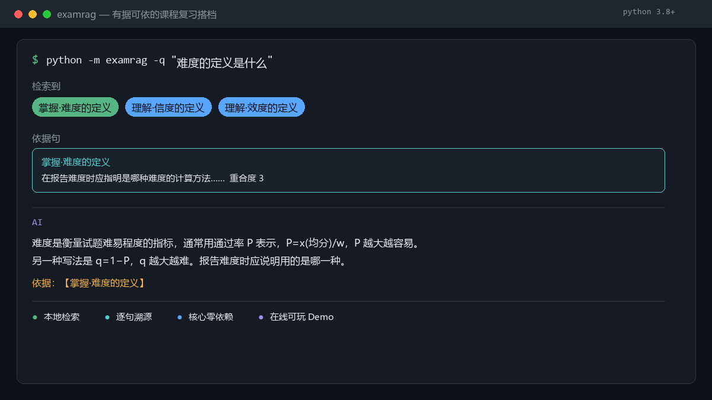

# ExamRAG

[](https://github.com/huiren789/exam-rag/actions/workflows/tests.yml)


[](https://examrag-demo.app.workbuddy.host/?sharecode=YTW7YFIS3R)

<div align="center">



**Course review you can actually verify**

**Zero dependencies · Traceable · Bring your own material** — retrieval runs locally to pick relevant chunks, only those chunks go to the LLM, and every answer points back to the exact source sentence.

[Live demo (no API key)](https://examrag-demo.app.workbuddy.host/?sharecode=YTW7YFIS3R) ·
[The problem](#the-problem) ·
[Use your own course in 30 seconds](#use-your-own-course-in-30-seconds)

</div>

**Language**: [中文](README.md) · **English** · [日本語](README_ja.md) · [한국어](README_ko.md) · [Español](README_es.md)

> Ships with a sample *Educational Measurement* course, but **drop in your own `data/material.txt` and it works for any subject**. Core retrieval uses only the Python standard library — no third-party packages needed. The author is the first real user, iterating over 4 rounds against a self-built evaluation set.

## The problem

Asking an LLM straight away gives answers that look right but may be fabricated. Reading the textbook yourself makes it hard to locate the exact passage you need.

ExamRAG does the "find the material" step locally. Retrieval is offline, free, and visible; only the selected chunks are sent to the model. The prompt requires the model to use only those chunks, cite them at the end, and answer "not mentioned in the material" when the data doesn't cover the question.

## Use your own course in 30 seconds

The bundled *Educational Measurement* material is just an example. To use your own course, format your notes as plain text like this:

```text
[Mastered·Concept name] Body text, one idea per paragraph.
[Understood·Another concept] ...
[Familiar·A third concept] ...
```

The three labels (Mastered / Understood / Familiar) control question-generation weighting. Then:

```bash
python -m examrag -q "your question" --material my.txt
```

Or set `EXAMRAG_MATERIAL=my.txt` once and forget it. Retrieval, citation, weighted question generation, and the Web UI all work unchanged — **this is the key difference from a tool locked to one course**.

## Features

- **Local lexical retrieval**: bigram frequency matching, title boost, TOC/summary downweight — pure standard library.
- **TF-IDF semantic retrieval**: optional `--semantic` mode, also standard library and offline.
- **Vector retrieval**: optional `--vector` mode with a cached embedding model (`pip install -e ".[vector]"`).
- **Sentence-level evidence**: answers and retrieval results highlight matched source sentences; click through to the original text in the Web UI.
- **Weighted question generation**: prioritizes "Mastered" chunks by ×3 / ×2 / ×1 weighting.
- **Query rewriting, key-point summarization, split-concept retrieval**: strategy layer injected via a single `retrieve_fn` contract.
- **Offline dry-run**: `--dry-run` prints retrieval results and the assembled prompt with no network or API key.
- **Web UI + FastAPI**: three tabs (ask / quiz / retrieve-only) and five endpoints with auto-generated Swagger docs.
- **89 offline tests**, CI on Python 3.8 / 3.11 / 3.13 plus ruff linting.

## Quick start

```bash
git clone https://github.com/huiren789/exam-rag.git
cd exam-rag
python -m examrag -q "What is difficulty?" --dry-run   # works offline, no key
python -m examrag                                       # interactive REPL
```

To call a real model, copy `.env.example` to `.env` and set `SILICONFLOW_API_KEY` (or any OpenAI-compatible endpoint via `EXAMRAG_BASE_URL`). The Web UI is powered by WorkBuddy Cloud so the [live demo](https://examrag-demo.app.workbuddy.host/?sharecode=YTW7YFIS3R) needs no key at all.

## Evaluation

Nine hand-labeled questions on the bundled course. `python -m examrag.evaluate --mode lexical|semantic|vector`.

| Mode | hit@1 | hit@3 | MRR |
| --- | --- | --- | --- |
| Lexical (default) | 0.778 | 0.889 | 0.815 |
| TF-IDF | 0.556 | 1.000 | 0.741 |

These are regression metrics on a historical sample, not a success rate on real-world use.

## Known limitations

- Default retrieval is lexical; TF-IDF helps with phrasing, embeddings are needed for true synonym-level recall.
- Evidence sentences use Chinese punctuation heuristics; very long or cross-sentence statements may be located imprecisely.
- Material must be formatted by hand — no PDF/Word import yet.
- No conversational context; each question is retrieved independently.
- The HTTP API listens on 127.0.0.1 with no auth; add authentication and rate limiting before exposing it.

## Docs

[中文完整文档](README.md) · [Architecture decisions](docs/adr) · [Contributing](CONTRIBUTING.md) · [Changelog](CHANGELOG.md)

## License

[MIT](LICENSE) © 2026 huiren789
