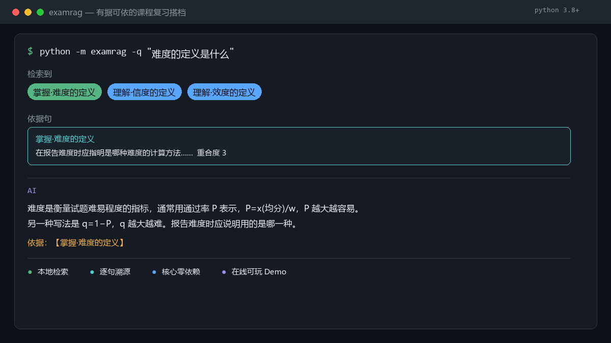

# ExamRAG

[](https://github.com/huiren789/exam-rag/actions/workflows/tests.yml)


[](https://examrag-demo.app.workbuddy.host/?sharecode=YTW7YFIS3R)

<div align="center">



**Un repaso de curso cuyas respuestas puedes comprobar**

Cada respuesta señala la frase exacta de la que sale. La búsqueda corre en local y el material de lectura se puede sustituir por el tuyo.

[Demo en vivo (sin API key)](https://examrag-demo.app.workbuddy.host/?sharecode=YTW7YFIS3R) ·
[El problema](#el-problema) ·
[Usa tu curso en 30 segundos](#usa-tu-curso-en-30-segundos)

</div>

**Idioma**：[中文](README.md) · [English](README_en.md) · [日本語](README_ja.md) · [한국어](README_ko.md) · **Español**

> El curso de *Medición Educativa* incluido es un ejemplo. Cambia `data/material.txt` y el mismo proceso sirve para cualquier asignatura. El núcleo de búsqueda solo necesita la biblioteca estándar de Python. El autor lo usó para su propio repaso y pasó por cuatro rondas de ajustes con un conjunto de preguntas preparado por él mismo.

## El problema

Si preguntas directamente a un modelo, la respuesta suena bien pero no sabes de dónde sale. Si lees el libro, acabas buscando el párrafo que necesitas en lugar de estudiando.

ExamRAG hace en tu máquina la parte de «encontrar el material». La búsqueda es offline y sus resultados se ven en pantalla; solo los bloques elegidos se envían al modelo. El prompt le exige usar únicamente esos bloques, citar la fuente al final y responder «no mencionado en el material» cuando la respuesta no esté ahí.

## Usa tu curso en 30 segundos

El material incluido es solo un ejemplo. Tus apuntes deben ser texto plano con las etiquetas que reconoce el analizador. Deja los nombres de las etiquetas en chino:

```text
【掌握·Nombre del concepto】Texto del concepto, una idea por párrafo.
【理解·Otro concepto】...
【了解·Tercer concepto】...
```

Las tres etiquetas — 掌握 / 理解 / 了解 (dominado / comprendido / conocido) — determinan cuánto pesa cada bloque al generar preguntas. Después:

```bash
python -m examrag -q "tu pregunta" --material my.txt
```

O configura `EXAMRAG_MATERIAL=my.txt` una sola vez para no repetir el parámetro. Cambia el archivo y todo lo demás sigue funcionando: búsqueda, citas, generación ponderada de preguntas e interfaz web. La herramienta no está atada a un solo curso. Los detalles están en [Formato del material](#formato-del-material).

## Funciones

- **Búsqueda léxica local**: frecuencia de bigramas, refuerzo de títulos y menor peso para índices y resúmenes. Solo biblioteca estándar.
- **Búsqueda TF-IDF**: `--semantic`, también offline y sin dependencias.
- **Búsqueda vectorial**: `--vector`, con embeddings en caché. La primera vez requiere `pip install -e ".[vector]"` y descargar un modelo.
- **Evidencia por frase**: los resultados muestran las frases de origen que coincidieron y su solapamiento léxico. En la interfaz web, al hacer clic en una cita o en una línea de evidencia, el bloque correspondiente se resalta entre los resultados.
- **Generación ponderada de preguntas**: 掌握 ×3 / 理解 ×2 / 了解 ×1.
- **Reescritura de consultas, resumen de puntos clave y división de conceptos paralelos**: todo pasa por un único contrato `retrieve_fn`, así que funciona en los tres modos de búsqueda.
- **Modo `--dry-run` sin conexión**: muestra los resultados y el prompt armado sin red ni clave. Con `--vector` usa un stub determinista y no carga ningún modelo.
- **Interfaz web y FastAPI**: tres pestañas (preguntar / generar preguntas / solo buscar) y cinco endpoints documentados con Swagger.
- **89 pruebas offline**, CI en Python 3.8 / 3.11 / 3.13 y análisis estático con ruff.

## Inicio rápido

```bash
git clone https://github.com/huiren789/exam-rag.git
cd exam-rag
python -m examrag -q "¿Qué es la dificultad?" --dry-run   # offline, sin clave
python -m examrag                                          # modo interactivo
```

Para llamar a un modelo real, copia `.env.example` a `.env` y pon `SILICONFLOW_API_KEY`. Cualquier endpoint compatible con OpenAI se configura con `EXAMRAG_BASE_URL`. La [demo en vivo](https://examrag-demo.app.workbuddy.host/?sharecode=YTW7YFIS3R) genera las respuestas con WorkBuddy Cloud, así que no pide clave; la búsqueda y las citas siguen viniendo del backend local.

## Evaluación

En `examples/eval_cases.json` están las 9 preguntas etiquetadas a mano y el bloque esperado para cada una. Se ejecuta con `python -m examrag.evaluate --mode lexical|semantic|vector`.

| Modo | hit@1 | hit@3 | MRR |
| --- | --- | --- | --- |
| Léxico (por defecto) | 0.778 | 0.889 | 0.815 |
| TF-IDF | 0.556 | 1.000 | 0.741 |

Son métricas de regresión sobre una muestra histórica. No indican con qué frecuencia acierta el programa durante un repaso real.

## Formato del material

Escribe una idea por párrafo y marca cada bloque con 掌握 / 理解 / 了解. El material de *Medición Educativa* incluido tiene 99 bloques de los capítulos 1, 2, 4, 5 y 6, además de resúmenes y ejercicios de fin de capítulo. El texto original no tiene bloques de cuerpo para el capítulo 3, y el capítulo 6 no lleva una línea de encabezado propia. Está dicho tal cual, sin rellenarlo artificialmente.

## Limitaciones

- La búsqueda por defecto compara palabras. TF-IDF ayuda con otras redacciones; para sinónimos hace falta embeddings.
- Las frases de evidencia se cortan usando la puntuación china. En frases muy largas o afirmaciones que abarcan varias oraciones, la localización puede ser imprecisa.
- El material hay que darle formato a mano. Todavía no se importan PDF ni Word.
- No hay contexto de conversación: cada pregunta se recupera por separado.
- La HTTP API escucha en 127.0.0.1 y no tiene autenticación. Añade autenticación y límite de peticiones antes de exponerla.
- La calidad de la respuesta depende del modelo. La cadena de llamadas está cubierta con funciones stub y un servidor local simulado; no se ha llamado a ninguna API comercial con una clave real.
- No pongas claves en los archivos de material. Un material que no sea de confianza puede contener inyección de prompt.

## Documentación

[Documento completo en 中文](README.md) · [English](README_en.md) · [日本語](README_ja.md) · [한국어](README_ko.md) · [Decisiones de arquitectura](docs/adr) · [Contribuir](CONTRIBUTING.md) · [Changelog](CHANGELOG.md)

## Licencia

[MIT](LICENSE) © 2026 huiren789
