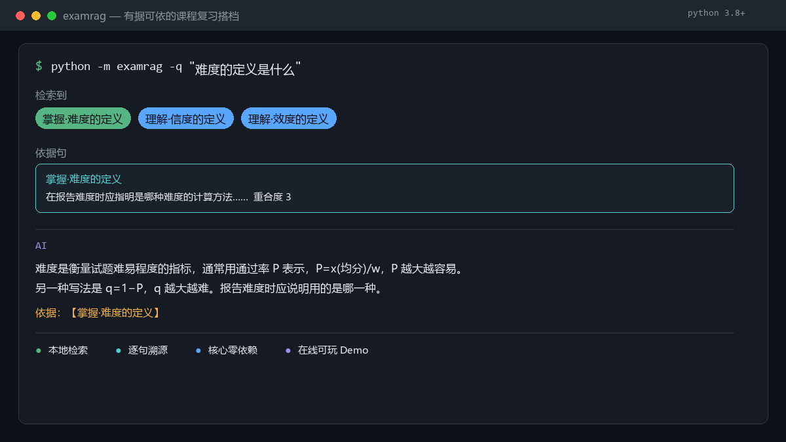

# ExamRAG

[](https://github.com/huiren789/exam-rag/actions/workflows/tests.yml)


[](https://examrag-demo.app.workbuddy.host/?sharecode=YTW7YFIS3R)

<div align="center">



**出典までたどれる、試験勉強の道具**

回答には出典の文がそのまま添きます。検索はローカルで動き、教材は好きなものに差し替えられます。

[オンラインデモ（API キー不要）](https://examrag-demo.app.workbuddy.host/?sharecode=YTW7YFIS3R) ·
[解決する問題](#解決する問題) ·
[30 秒で自分の科目に切り替える](#30-秒で自分の科目に切り替える)

</div>

**言語**：[中文](README.md) · [English](README_en.md) · **日本語** · [한국어](README_ko.md) · [Español](README_es.md)

> 同梱の「教育測定」教材はサンプルです。`data/material.txt` を差し替えれば、同じ手順でどの科目にも使えます。検索のコアは Python 標準ライブラリだけです。作者本人が自分の勉強に使い、自作の評価問題集で 4 回改良しました。

## 解決する問題

いきなり LLM に聞くと、文章は整っていても出典が分かりません。教科書を自分で読むと、今必要な一節を探す方に時間がかかります。

ExamRAG は「資料を探す」部分を自分の機械で行います。検索はオフラインで、結果も画面に出ます。選んだブロックだけをモデルに渡し、その資料だけを使うこと・最後に出典を書くこと・資料になければ「資料に記載なし」と答えることをプロンプトで要求します。

## 30 秒で自分の科目に切り替える

同梱教材は例にすぎません。ノートを次の形式のプレーンテキストに整えます。タグ名は中国語のままにしてください（解析器がこの文字列だけを認識します）。

```text
【掌握·概念名】概念を一段で説明する本文。
【理解·別の概念】……
【了解·三つ目の概念】……
```

3 つのタグ（掌握 / 理解 / 了解＝習得・理解・把握）が出題時の重み付けを決めます。あとは：

```bash
python -m examrag -q "あなたの質問" --material my.txt
```

または `EXAMRAG_MATERIAL=my.txt` を一度設定すれば、毎回引数を書かなくて済みます。ファイルを替えても検索・出典・重み付き出題・Web UI はそのまま動きます。特定の科目に固定された道具ではない、ということです。形式の詳細は[資料形式](#資料形式)を参照してください。

## 主な機能

- **ローカル語彙検索**：bigram の出現回数、タイトルの加重、目次・要約ブロックの減点。標準ライブラリのみ。
- **TF-IDF 検索**：`--semantic`。こちらもオフラインで依存パッケージ不要。
- **ベクトル検索**：`--vector`。embedding をキャッシュします。初回は `pip install -e ".[vector]"` とモデルのダウンロードが必要です。
- **文単位の根拠**：検索結果に一致した原文の文と語面の重みが表示されます。Web UI で出典や根拠の行をクリックすると、該当する資料ブロックがハイライトされます。
- **重み付き出題**：掌握 ×3 / 理解 ×2 / 了解 ×1。
- **クエリの書き換え・要点まとめ・並列概念の分割検索**：単一の `retrieve_fn` 契約を通るため、どの検索モードでも効きます。
- **オフライン dry-run**：`--dry-run` で検索結果と組み立てたプロンプトを表示します。通信もキーも不要。`--vector` を付けても決定論的なスタブを使うのでモデルは読み込みません。
- **Web UI と FastAPI**：3 つのタブ（質問 / 出題 / 検索のみ）と 5 つのエンドポイント、Swagger 自動生成。
- **89 件のオフラインテスト**、CI は Python 3.8 / 3.11 / 3.13 と ruff 静的検査。

## クイックスタート

```bash
git clone https://github.com/huiren789/exam-rag.git
cd exam-rag
python -m examrag -q "難度とは" --dry-run   # オフライン・キー不要
python -m examrag                             # 対話モード
```

実際にモデルを呼ぶ場合は `.env.example` を `.env` にコピーして `SILICONFLOW_API_KEY` を設定します。OpenAI 互換の別エンドポイントなら `EXAMRAG_BASE_URL` で切り替えられます。上の[デモ](https://examrag-demo.app.workbuddy.host/?sharecode=YTW7YFIS3R)は生成に WorkBuddy Cloud を使うのでキーは不要で、検索と出典はローカルのバックエンドが担当します。

## 検索評価

`examples/eval_cases.json` に、手作業でラベル付けした 9 問と期待するブロックの組が入っています。`python -m examrag.evaluate --mode lexical|semantic|vector` で実行します。

| モード | hit@1 | hit@3 | MRR |
| --- | --- | --- | --- |
| 語彙（既定） | 0.778 | 0.889 | 0.815 |
| TF-IDF | 0.556 | 1.000 | 0.741 |

これらは過去のサンプルに対する回帰指標であり、実際の勉強で正しい割合を示すものではありません。

## 資料形式

1 段落に 1 つの概念を書き、各ブロックに 掌握 / 理解 / 了解 のタグを付けます。同梱の「教育測定」資料は 99 ブロックで、第 1・2・4・5・6 章の本文と章末のまとめ・練習を含みます。元の資料に第 3 章の本文ブロックがなく、第 6 章には単独の見出し行もありません。その事実をそのまま記載しており、補ってはいません。

## 制限事項

- 既定は語彙一致です。言い回しの差は TF-IDF である程度吸収できますが、同義語レベルの検索には embedding が必要です。
- 根拠句は中国語の句読点を手がかりに切ります。非常に長い文や複数文にわたる記述は、位置がずれることがあります。
- 教材は手動で整形する必要があります。PDF / Word の取り込みは未対応です。
- 会話の文脈は保持しません。各質問が独立に検索します。
- HTTP API は 127.0.0.1 で待ち受け、認証はありません。外部に公開するなら認証とレート制限を追加してください。
- 回答の質は使うモデルに依存します。呼び出し経路はスタブ関数とローカルの模擬サーバーでテスト済みですが、実キーで商用 API を呼んだことはありません。
- キーを資料ファイルに書かないでください。信頼できない資料はプロンプトインジェクションになり得ます。

## ドキュメント

[中文完全版](README.md) · [English](README_en.md) · [設計判断](docs/adr) · [コントリビュート](CONTRIBUTING.md) · [変更履歴](CHANGELOG.md)

## ライセンス

[MIT](LICENSE) © 2026 huiren789
