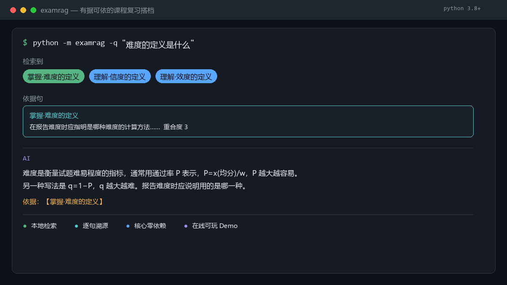

# ExamRAG

[](https://github.com/huiren789/exam-rag/actions/workflows/tests.yml)


[](https://examrag-demo.app.workbuddy.host/?sharecode=YTW7YFIS3R)

<div align="center">



**출처까지 짚어 볼 수 있는 학습 도우미**

답변에는 근거가 된 문장이 그대로 붙습니다. 검색은 로컬에서 돌고, 교재는 원하는 자료로 바꿀 수 있습니다.

[온라인 데모(API 키 불필요)](https://examrag-demo.app.workbuddy.host/?sharecode=YTW7YFIS3R) ·
[해결하는 문제](#해결하는-문제) ·
[30초 만에 내 과목으로 바꾸기](#30초-만에-내-과목으로-바꾸기)

</div>

**언어**：[中文](README.md) · [English](README_en.md) · [日本語](README_ja.md) · **한국어** · [Español](README_es.md)

> 포함된 「교육 측정」 자료는 예시입니다. `data/material.txt`를 바꾸면 같은 절차로 모든 과목에 쓸 수 있습니다. 검색 핵심은 Python 표준 라이브러리뿐입니다. 작성자가 직접 자기 학습에 사용하고 자체 평가 문제집으로 4회 개선했습니다.

## 해결하는 문제

LLM에 바로 물어보면 문장은 자연스럽지만 출처를 찾을 수 없습니다. 교재를 직접 읽으면 필요한 부분을 찾는 데 시간이 걸립니다.

ExamRAG는 「자료 찾기」를 내 컴퓨터에서 합니다. 검색은 오프라인으로 돌고 결과가 화면에 보입니다. 선택한 블록만 모델에 보내며, 그 자료만 쓸 것·끝에 출처를 적을 것·자료에 없으면 「자료에 없음」이라고 답할 것을 프롬프트로 요구합니다.

## 30초 만에 내 과목으로 바꾸기

포함된 자료는 예시일 뿐입니다. 노트를 다음 형식의 일반 텍스트로 정리하세요. 태그 이름은 중국어 그대로 두어야 합니다. 파서가 이 문자열만 인식합니다.

```text
【掌握·개념 이름】한 문단으로 개념을 설명하는 본문.
【理解·다른 개념】……
【了解·세 번째 개념】……
```

세 태그(掌握 / 理解 / 了解 = 숙달 / 이해 / 파악)가 출제 가중치를 정합니다. 그다음:

```bash
python -m examrag -q "내 질문" --material my.txt
```

또는 `EXAMRAG_MATERIAL=my.txt`를 한 번 설정하면 매번 인자를 넣지 않아도 됩니다. 파일을 바꿔도 검색·출처·가중 출제·웹 UI가 그대로 동작합니다. 특정 과목에 묶인 도구가 아니라는 뜻입니다. 형식의 자세한 내용은 [자료 형식](#자료-형식)을 보세요.

## 주요 기능

- **로컬 어휘 검색**: bigram 빈도, 제목 가중, 목차·요약 블록 감점. 표준 라이브러리만 사용.
- **TF-IDF 검색**: `--semantic`. 마찬가지로 오프라인이며 의존성이 없습니다.
- **벡터 검색**: `--vector`. embedding을 캐시합니다. 첫 실행 시 `pip install -e ".[vector]"`와 모델 다운로드가 필요합니다.
- **문장 단위 근거**: 검색 결과에 맞은 원문 문장과 어휘 겹침이 표시됩니다. 웹 UI에서 출처나 근거 줄을 클릭하면 해당 자료 블록이 하이라이트됩니다.
- **가중 출제**: 掌握 ×3 / 理解 ×2 / 了解 ×1.
- **질문 재작성·핵심 요약·병렬 개념 분리 검색**: 모두 하나의 `retrieve_fn` 계약을 거치므로 모든 검색 모드에 적용됩니다.
- **오프라인 dry-run**: `--dry-run`으로 검색 결과와 조립된 프롬프트를 보여줍니다. 통신이나 키가 필요 없습니다. `--vector`를 함께 써도 결정론적 스텁을 쓰므로 모델을 읽지 않습니다.
- **웹 UI와 FastAPI**: 세 탭(질문 / 출제 / 검색만)과 다섯 엔드포인트, Swagger 자동 생성.
- **89개 오프라인 테스트**, CI는 Python 3.8 / 3.11 / 3.13 및 ruff 정적 검사.

## 빠른 시작

```bash
git clone https://github.com/huiren789/exam-rag.git
cd exam-rag
python -m examrag -q "난이도란" --dry-run   # 오프라인, 키 불필요
python -m examrag                             # 대화형 모드
```

실제 모델을 호출하려면 `.env.example`을 `.env`로 복사하고 `SILICONFLOW_API_KEY`를 설정하세요. OpenAI 호환 엔드포인트는 `EXAMRAG_BASE_URL`로 바꿀 수 있습니다. 위의 [데모](https://examrag-demo.app.workbuddy.host/?sharecode=YTW7YFIS3R)는 생성에 WorkBuddy Cloud를 쓰므로 키가 필요 없고, 검색과 출처는 로컬 백엔드가 맡습니다.

## 검색 평가

`examples/eval_cases.json`에 수동으로 라벨링한 9개 질문과 기대 블록이 들어 있습니다. `python -m examrag.evaluate --mode lexical|semantic|vector`로 실행합니다.

| 모드 | hit@1 | hit@3 | MRR |
| --- | --- | --- | --- |
| 어휘(기본) | 0.778 | 0.889 | 0.815 |
| TF-IDF | 0.556 | 1.000 | 0.741 |

이 수치는 과거 표본에 대한 회귀 지표이며, 실제 학습에서 맞는 비율을 뜻하지 않습니다.

## 자료 형식

한 문단에 개념 하나를 쓰고 각 블록에 掌握 / 理解 / 了解 태그를 붙입니다. 포함된 「교육 측정」 자료는 99개 블록으로 제1·2·4·5·6장 본문과 단원 말 요약·연습을 담고 있습니다. 원본 자료에 3장 본문 블록이 없고 6장에는 별도 제목 줄도 없습니다. 있는 그대로 적었으며 임의로 채우지 않았습니다.

## 제한 사항

- 기본 검색은 어휘 매칭입니다. 표현 차이는 TF-IDF로 어느 정도 줄지만, 동의어 수준의 검색에는 embedding이 필요합니다.
- 근거 문장은 중국어 문장부호를 기준으로 자릅니다. 매우 긴 문장이나 여러 문장에 걸친 서술은 위치가 어긋날 수 있습니다.
- 자료는 직접 정리해야 합니다. PDF / Word 가져오기는 아직 없습니다.
- 대화 문맥은 유지하지 않습니다. 각 질문이 독립적으로 검색합니다.
- HTTP API는 127.0.0.1에서만 듣고 인증이 없습니다. 외부에 노출하려면 인증과 호출 제한을 추가해야 합니다.
- 답변 품질은 모델에 달려 있습니다. 호출 경로는 스텁 함수와 로컬 모의 서버로 검증했지만, 실제 키로 상용 API를 호출한 적은 없습니다.
- 키를 자료 파일에 넣지 마세요. 신뢰할 수 없는 자료는 프롬프트 인젝션이 될 수 있습니다.

## 문서

[中文 전체 문서](README.md) · [English](README_en.md) · [日本語](README_ja.md) · [설계 판단](docs/adr) · [기여 방법](CONTRIBUTING.md) · [변경 이력](CHANGELOG.md)

## 라이선스

[MIT](LICENSE) © 2026 huiren789
